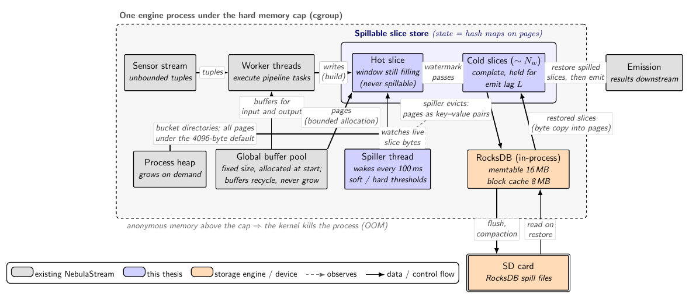
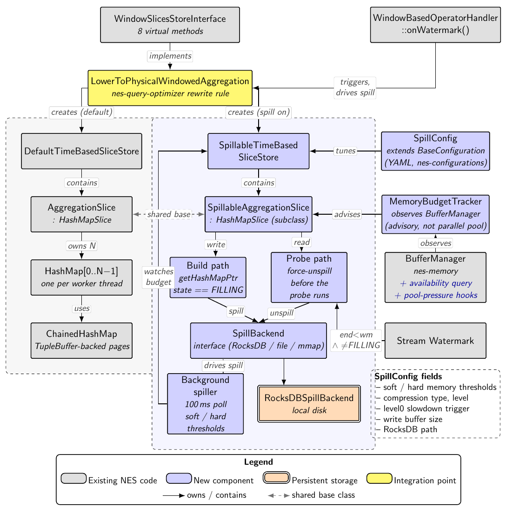
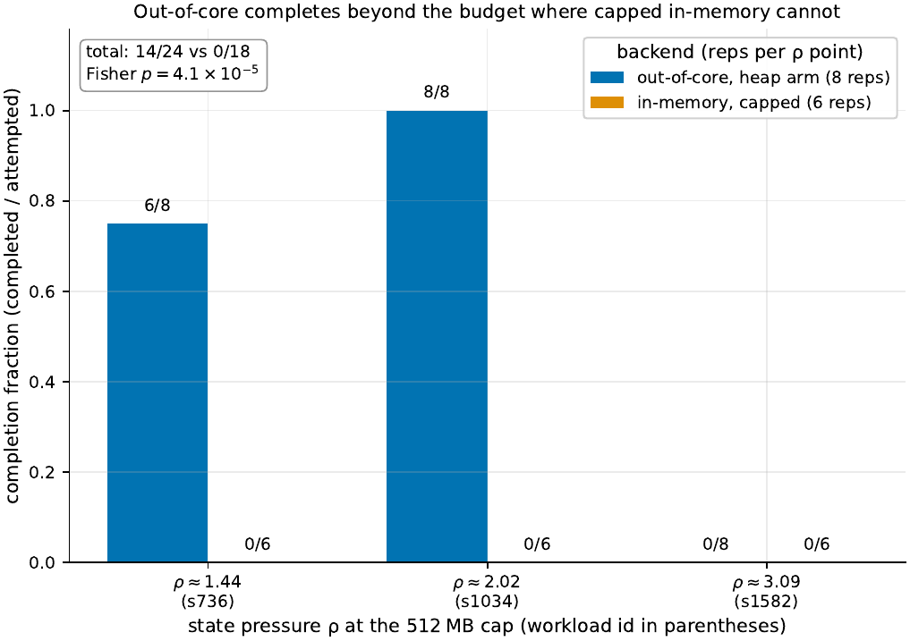
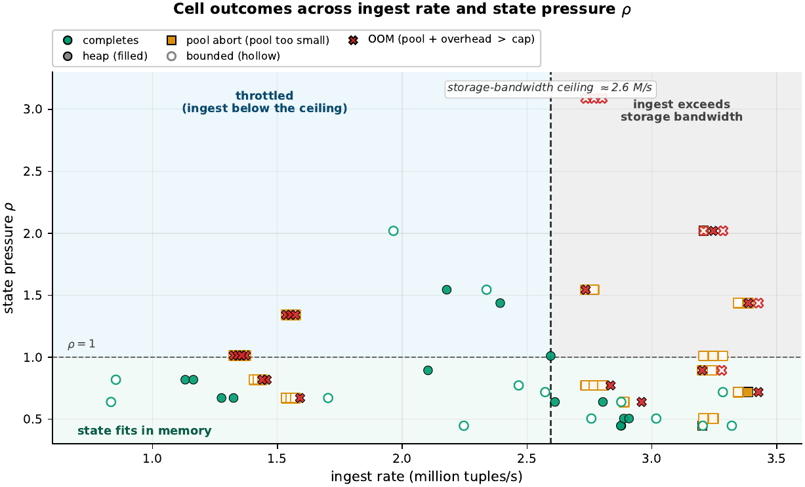
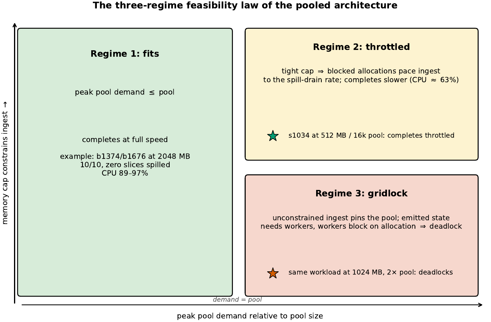
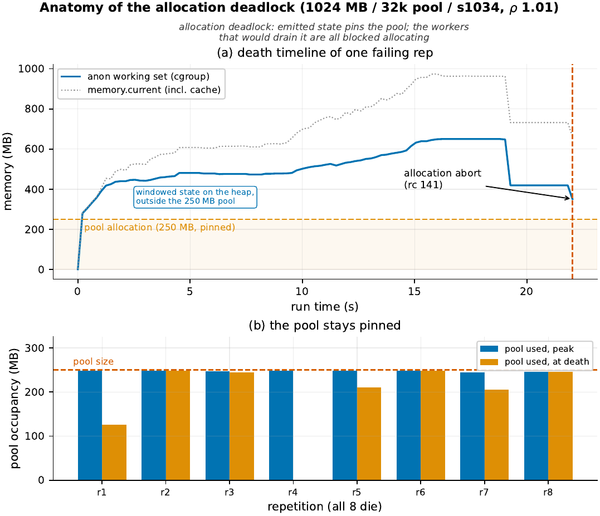
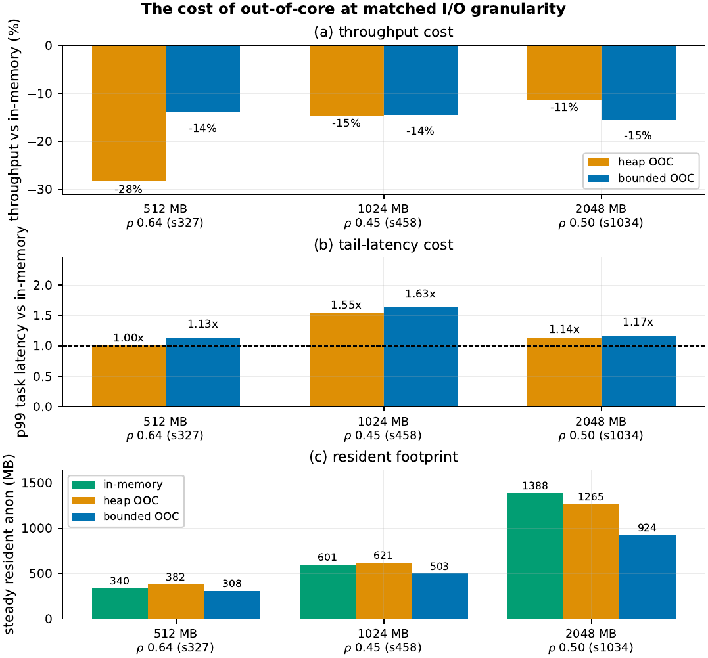
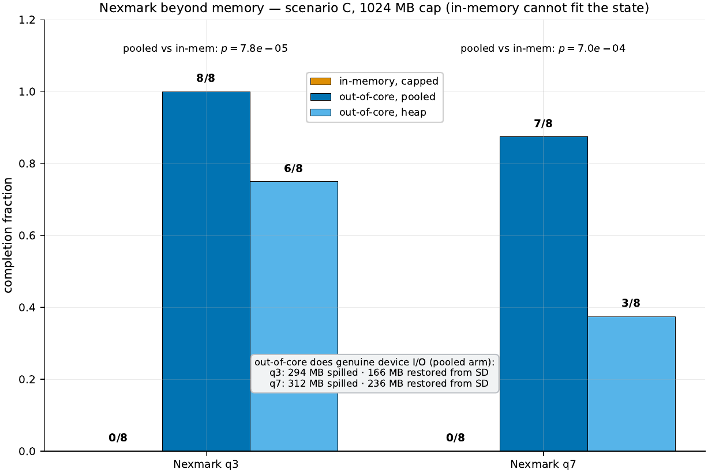
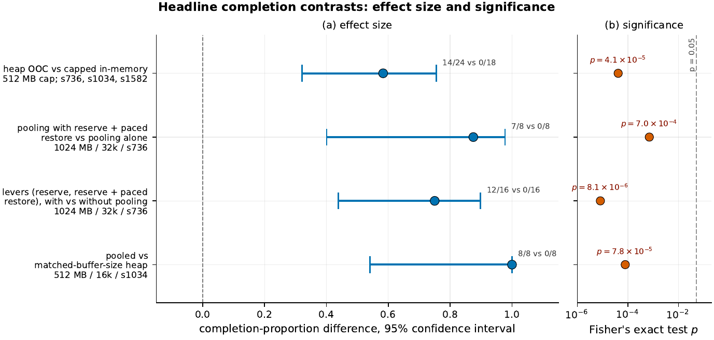

# Out-of-Core Stream Processing in NebulaStream

**A RocksDB-based state backend for memory-constrained edge devices**

Code, experiments and data for a bachelor's thesis · Computer Engineering · TU Berlin, DIMA group
(Prof. Dr. Volker Markl) · 2026 · Author: Benjamin Steinbüchel

⚙️ [Engine source (fork)](nebulastream-Out-of-Core-Stream-Processing/) · 📊 [Analysis scripts](analysis/) ·
🧪 [Evaluation harness and raw data](nebulastream-Out-of-Core-Stream-Processing/.planning/eval-phase/lag-validation/)

---

## TL;DR

[NebulaStream](https://nebula.stream) is a stream-processing engine for the Internet of Things. Like most
stream processors, it keeps the state of windowed aggregations in main memory. On an edge device with a few
hundred megabytes of RAM, a large window simply does not fit, and the Linux kernel kills the process (OOM).

This project adds an **out-of-core (OOC) state backend** to NebulaStream. Under memory pressure it spills
completed window slices to an embedded **RocksDB** instance on local storage (an SD card) and restores them
when the window must emit its result. It was evaluated in **about 3,100 measured runs** under hard memory caps
of 512, 1024 and 2048 MB.

**Main results**

- **It works where the stock engine cannot.** At a 512 MB cap, the backend completes workloads whose state is
  1.4 to 2 times the memory budget in **14 of 24 runs**. The unmodified engine completes **0 of 18**
  (Fisher's exact *p* = 4.1 × 10⁻⁵). Output checksums match an unconstrained reference run.
- **The cost is moderate.** Where both configurations complete, throughput drops by **11–16 %** at matched I/O
  buffer size, and p99 task latency rises by a factor of 1.1–1.6.
- **One engine default was hiding all window state from the buffer pool.** With the 4096-byte default operator
  buffer, no window state ever entered NebulaStream's buffer pool. Raising one setting enables pooling.
  Combined with new pool-pressure levers, it recovers most previously failing workloads and, at one measured
  point, reaches **98 % of in-memory throughput with 25 % less memory**.
- **Failures follow a three-regime law** (fits / throttled / gridlock). The remaining failure mode is an
  **allocation deadlock**, which was diagnosed and shown with direct instrumentation.
- **It transfers to a realistic benchmark.** On a Nexmark bid stream whose state exceeds a 1024 MB cap, the
  pooled backend completes 8/8 (q3) and 7/8 (q7) runs. The in-memory engine completes 0/8.

---

## Contents

- [Motivation](#motivation)
- [What was built](#what-was-built)
- [How it was evaluated](#how-it-was-evaluated)
- [Results](#results)
- [Conclusions and practical guidance](#conclusions-and-practical-guidance)
- [Repository layout](#repository-layout)
- [Getting started](#getting-started)
- [Reproducing the evaluation](#reproducing-the-evaluation)
- [Other experiment phases](#other-experiment-phases)
- [Documentation of AI tool usage](#documentation-of-ai-tool-usage)
- [License and citation](#license-and-citation)

---

## Motivation

IoT deployments push computation toward the edge: gateways, single-board computers and other devices with
tight memory budgets. Windowed aggregations such as `GROUP BY key WINDOW TUMBLING(...)` hold one hash map of
partial results per window. With long windows or many distinct keys, that state can easily outgrow RAM. In an
in-memory engine the result is an out-of-memory kill and a lost query.

The thesis asks one central question: **can NebulaStream process window state larger than memory on
edge-class devices, and at what cost?** It is split into six research questions:

| RQ | Topic | Question |
|----|-------|----------|
| RQ0 | Design | How can an out-of-core store be integrated into NebulaStream's push-based execution model? |
| RQ1 | Effectiveness | Can a RocksDB-based backend process tumbling-window workloads whose state exceeds memory? |
| RQ2 | Cost | What are the throughput and tail-latency costs of a research-informed RocksDB configuration? |
| RQ3 | Memory behavior | How does memory evolve as state grows past the cap, and what explains the failures? |
| RQ4 | Resource use | How do CPU utilization and disk I/O evolve as state grows beyond memory? |
| RQ5 | Storage efficiency | How efficiently does RocksDB store the state (write amplification, footprint)? |

## What was built

The spill machinery sits underneath NebulaStream's existing slice store. Query compilation and the operators
above it are unchanged.



*How window state flows through the engine. Grey: existing NebulaStream. Blue: added in this thesis. Orange:
storage engine and device.*

The core components (all in [`nes-physical-operators`](nebulastream-Out-of-Core-Stream-Processing/nes-physical-operators/)
and [`nes-query-compiler`](nebulastream-Out-of-Core-Stream-Processing/nes-query-compiler/)):

| Component | Role |
|-----------|------|
| `SpillableTimeBasedSliceStore` | Drop-in replacement for the default in-memory slice store. It tracks resident slice bytes and owns the spill backend. |
| `SpillableAggregationSlice` | Subclass of `HashMapSlice`. The build path is unchanged; the probe path restores spilled state before a window is emitted. |
| Background spiller | Wakes every 100 ms. Spills cold, completed slices above a **soft threshold** and spills synchronously above a **hard threshold**. |
| `SpillBackend` / `RocksDBSpillBackend` | Storage interface with Null, In-memory and RocksDB implementations (lz4, bounded memtable and block cache). |
| `SliceSerializer` | Turns a window's chained hash map into flat key–value records and back, byte for byte. |
| `SpillConfig` | All settings, exposed as worker configuration (`--worker.default_query_execution.spill.*`). |
| Pool-pressure levers | Reserve-based spilling, paced restore and optional allocation backpressure, driven by `BufferManager` hooks. |
| Growth signal, page release | Make intra-slice growth visible to the spiller (`spill.growth_spill_check_stride`) and return freed pool pages to the OS after a drain (`--worker.pooled_release_watermark_pct`). |

Every mechanism is **off by default**. With all switches closed, the engine is byte-identical to upstream
NebulaStream.

<details>
<summary>Class-level view of the integration</summary>



</details>

## How it was evaluated

The experiments ran on a desktop host (Intel i7-10700K, 32 GB RAM). A Docker container recreated the resource
limits of an edge device:

| Resource | Constraint |
|----------|-----------|
| Memory | Hard cgroup cap of **512 / 1024 / 2048 MB**, swap disabled (the only variable that changes between experiments) |
| CPU | 2 pinned physical cores |
| Spill storage | Consumer SD card (SanDisk Extreme Pro, ext4), bind-mounted into the container |
| Input | RAM-backed tmpfs, so the input never competes with spill I/O |

**Workloads.** The main workloads are synthetic sensor streams with Zipf-skewed keys and out-of-order jitter,
named by their steady-state footprint in MB (`s327`, `s458`, `s736`, `s1034`, `s1582`, …). State pressure
**ρ** is that footprint divided by the cap, so ρ > 1 means the state does not fit in memory. Nexmark
queries q3 and q7 serve as a transfer test on a realistic benchmark.

**Methodology.** 46 campaigns and about 3,100 measured runs, with 8–10 repetitions per cell. Every follow-up
hypothesis was pre-registered. Completion contrasts use Fisher's exact test, and correctness is checked by
output checksum against an unconstrained run. Six memory probes record anonymous, file-backed, pool and RocksDB
memory over time.

## Results

### 1. Out-of-core completes where in-memory cannot (RQ1)



At the 512 MB cap the stock engine fails every run once the state exceeds memory. The OOC backend completes
14 of 24 runs at ρ ≈ 1.4–2.0. Correctness is verified by checksum while spilling.

### 2. Completion is a race between ingest and drain (RQ1, RQ4)



Whether a run completes depends on whether the spiller can drain state to the SD card as fast as it arrives.
It does not depend on a fixed state-size threshold. Above the SD card's write-bandwidth ceiling
(≈ 2.6 M tuples/s here), runs fail no matter how the engine is configured. In that regime the I/O path is the
limit.

### 3. The three-regime feasibility law and the allocation deadlock (RQ3)



With pooled allocation, every outcome falls into one of three regimes:

1. **Fits.** Peak pool demand stays within the pool, and the run completes at full speed.
2. **Throttled.** A tight cap blocks allocations, which paces ingest down to the drain rate. The run completes
   more slowly.
3. **Gridlock.** Unconstrained ingest pins the pool. Emitted state needs worker threads, and every worker is
   blocked on allocation, so the run deadlocks. Direct instrumentation shows this in 118 of 138 stalls.

<details>
<summary>The allocation deadlock, instrumented</summary>



</details>

### 4. The cost of going out-of-core (RQ2)



| Comparison | Throughput | p99 latency |
|------------|-----------:|------------:|
| Matched I/O buffer size (~8 KB), both complete | −11 to −16 % | 1.1–1.6 × |
| Engine-default configuration | −3 to −22 % | — |
| Bounded OOC vs in-memory, anonymous memory (2048 MB, s1034) | −33 % memory (924 vs 1388 MB) | ≈ 1.17 × |
| Nexmark beyond memory (vs uncapped reference) | −50 to −63 % | 1.1–1.2 × |

DRAM and an SD card differ by orders of magnitude in bandwidth, yet the measured loss is a fraction. Four
mechanisms explain the gap: the aggregation reduces data before it is stored (device-level write
amplification of 1.0–1.8), skewed keys keep the hot set in memory, restores below the memory boundary are
served from the page cache, and the background spiller overlaps device latency with computation.

### 5. Transfer to Nexmark



On a Nexmark bid stream whose state exceeds the 1024 MB cap, the pooled backend completes 8/8 (q3) and 7/8
(q7). The in-memory engine completes 0/8. The backend does real device I/O here: about 300 MB per query is
spilled to the SD card, and 170–240 MB of it is read back on restore.

### Verdicts at a glance

| RQ | Verdict | Key number |
|----|---------|-----------|
| RQ0 | Met by construction | ~3,100 runs through the unchanged slice-store interface |
| RQ1 | Met inside a characterized operating window | 14/24 vs 0/18 at 512 MB, *p* = 4.1 × 10⁻⁵ |
| RQ2 | Met | −11 to −16 % throughput, p99 × 1.1–1.6 |
| RQ3 | Met | pooled vs unpooled with levers: 12/16 vs 0/16, *p* = 8.1 × 10⁻⁶; deadlock in 118/138 stalls |
| RQ4 | Met | throttled regime at 62 % CPU, I/O-bound |
| RQ5 | Met (with a stated proxy) | hash-map headers are 51 % of state; write amplification 1.0–1.8 |



## Conclusions and practical guidance

- **Larger-than-memory window state on edge budgets is feasible** with a spill-to-RocksDB backend, at a
  moderate throughput cost, inside characterized operating windows.
- **Storage bandwidth is the hard limit.** Once the SD card cannot keep up with the spill stream, no
  engine-side mechanism helps. A deployment then needs a faster device, fewer bytes per window, or ingest
  throttling.
- **Check your allocation assumptions.** A single default (`operator_buffer_size = 4096` < page size) kept
  all window state off the buffer pool and made the pool-pressure levers act on the wrong memory for an
  entire campaign.

**Recommended configuration for an edge deployment** (within the tested scope):

1. Enable page pooling by raising the operator buffer size to the page size (e.g. `operator_buffer_size=8192`).
2. Size the buffer pool to hold the hot band, with pool, overhead and base footprint together below 90 % of
   the cap.
3. Derive the soft threshold from the memory cap, not from the pool size.
4. Enable the pool reserve lever at 15 % (`pool_reserve_pct=15`) and paced restore
   (`paced_trigger_flush=true`).
5. Leave allocation backpressure off.

**Future work:** role-aware allocation (a reserve for the drain side that would remove the deadlock),
closed-loop ingest admission, smaller hash-map entries (about 20 % state reduction), spilling open windows,
sliding windows, and experiments across core counts and storage devices.

---

## Repository layout

```
.
├── README.md                                   ← you are here
├── docs/figures/                               ← figures used in this README
├── analysis/
│   ├── figures/                                ← Python scripts that regenerate every data figure
│   ├── gen_tables.py                           ← per-cell result tables from the raw TSVs
│   └── rb32-config-contrast/                   ← RocksDB backend-size experiment (16/8 vs 32/32)
├── nebulastream-Out-of-Core-Stream-Processing/ ← NebulaStream fork with the OOC backend
│   ├── nes-physical-operators/                 ← spillable slice store, spill backends, serializer
│   ├── nes-query-compiler/                     ← SpillConfig + lowering to the spillable store
│   ├── nes-memory/                             ← buffer-manager hooks (pool pressure, page release)
│   ├── .planning/eval-phase/lag-validation/    ← final evaluation harness + raw results
│   ├── .planning/eval-phase/e3big/             ← 10k-cell synthetic sweep harness
│   ├── REPRODUCE-10K-SWEEP.md                  ← runbook for the 10k sweep
│   └── docs/ai-usage/                          ← documentation of AI tool usage (see below)
├── evaluation-10k-synthetic/                   ← results of the 10,044-cell characterisation sweep
└── Microbenchmark-BA/                          ← stand-alone RocksDB db_bench study used to pick the config
```

## Getting started

### Prerequisites

- Linux (x86_64 or arm64) with Docker ≥ 18.09 (BuildKit). macOS with Docker Desktop also works for building.
- ~30 GB free disk space (the debug build directory alone is about 14 GB).
- Python 3 with `pandas`, `numpy`, `matplotlib` and `scipy` for the analysis and figure scripts.

### 1. Clone

```bash
git clone --recurse-submodules https://github.com/Oblision/Bachelor-Thesis-RocksDB-IoT.git
```

```bash
cd Bachelor-Thesis-RocksDB-IoT/nebulastream-Out-of-Core-Stream-Processing
```

The NebulaStream fork is vendored as plain files. The only submodule is RocksDB, which the stand-alone
microbenchmark uses.

### 2. Build the development image (with RocksDB)

The fork's `vcpkg.json` already lists RocksDB (with lz4 and zstd). Build the local development image and tag
it `local-rocksdb`, the name the evaluation scripts expect:

```bash
./scripts/install-local-docker-environment.sh -l -y --libstdcxx --no-sanitizer --name rocksdb
```

### 3. Build the engine and the `systest` runner

```bash
docker run --rm --workdir /workspace -v "$PWD:/workspace" nebulastream/nes-development:local-rocksdb \
  bash -c "cmake -S . -B cmake-build-debug -G Ninja -DCMAKE_BUILD_TYPE=Debug -DUSE_LOCAL_VCPKG=1 && \
           cmake --build cmake-build-debug --target systest -j"
```

The first build takes 30–60 minutes while vcpkg builds the dependencies. Later builds are incremental.

### 4. Run the unit tests for the OOC backend

```bash
docker run --rm --workdir /workspace -v "$PWD:/workspace" nebulastream/nes-development:local-rocksdb \
  bash -c "cmake --build cmake-build-debug -j && \
           ctest --test-dir cmake-build-debug -R 'Spill|SliceSerializer|RocksDB' --output-on-failure"
```

### 5. Run a query with spilling enabled

Spilling is configured through worker options. A minimal example under a 512 MB container cap:

```bash
docker run --rm --memory=512m --memory-swap=512m --workdir /workspace -v "$PWD:/workspace" \
  nebulastream/nes-development:local-rocksdb \
  cmake-build-debug/nes-systests/systest/systest \
    -t .planning/eval-phase/lag-validation/work/lagval.test -- \
    --worker.default_query_execution.operator_buffer_size=8192 \
    --worker.default_query_execution.spill.enabled=true \
    --worker.default_query_execution.spill.rocksdb_path=/tmp/nes-spill \
    --worker.default_query_execution.spill.soft_threshold_mb=182 \
    --worker.default_query_execution.spill.hard_threshold_mb=234 \
    --worker.default_query_execution.spill.write_buffer_size_mb=16 \
    --worker.default_query_execution.spill.block_cache_size_mb=8 \
    --worker.default_query_execution.spill.compression=lz4 \
    --worker.default_query_execution.spill.pool_reserve_pct=15 \
    --worker.default_query_execution.spill.paced_trigger_flush=true
```

`lagval.test` is a template; `run-cell.sh` (below) fills in its placeholders (`${TUPLES}`, `${WINDOW}`, …).
To run it by hand, substitute them first. See
[`SpillConfig.hpp`](nebulastream-Out-of-Core-Stream-Processing/nes-query-compiler/interface/SpillConfig.hpp)
for every option and its default.

## Reproducing the evaluation

The final evaluation runs through the **lag-validation harness** in
[`nebulastream-Out-of-Core-Stream-Processing/.planning/eval-phase/lag-validation/`](nebulastream-Out-of-Core-Stream-Processing/.planning/eval-phase/lag-validation/).
Each run (one "cell") is one capped container execution:

```bash
cd nebulastream-Out-of-Core-Stream-Processing/.planning/eval-phase/lag-validation
# label  tuples  window_ms  emit_rate  emit_lag_ms  cap_mb  spill  sample  soft  hard  pool
bash run-cell.sh demo_s736_r1 <tuples> <window_ms> <emit_rate> <emit_lag_ms> 512 on on 182 234 16000
```

- Each run writes one 34-column TSV row to `results/` and a 0.2-second memory trace to `traces/`.
- The campaign scripts (`final_matrix.sh`, `lever_matrix.sh`, `nx_matrix.sh`, `gaps_run.sh`, …) encode the
  exact cells of each campaign. The `EXPERIMENT-*.md` and `FINDINGS-*.md` files next to them hold the
  pre-registered hypotheses and their outcomes.
- By default, spill files go to an SD card mounted at `/mnt/sd-spill`. Set `SPILL_HOST_DIR=tmp` to spill
  inside the container instead.
- **All raw results are committed** (`results/*.tsv`, `traces/`), so the figures and tables can be rebuilt
  without re-running anything. The figure PDFs land in `analysis/figures/out/`, the per-cell table in
  `analysis/out/`:

```bash
bash analysis/figures/make_all.sh
```

```bash
python3 analysis/rb32-config-contrast/fig_rb32.py
```

```bash
python3 analysis/gen_tables.py
```

## Other experiment phases

The final evaluation grew out of two earlier phases, which are kept for completeness:

- **[`Microbenchmark-BA/`](Microbenchmark-BA/)**: a stand-alone RocksDB `db_bench` study of compression,
  write-buffer, L0 trigger and block-cache settings under a 512 MB cap. It produced the research-informed
  RocksDB configuration used by the backend. See its [README](Microbenchmark-BA/README.md).
- **[`evaluation-10k-synthetic/`](evaluation-10k-synthetic/)**: an early 10,044-cell characterisation sweep
  (54 repetitions × 186 configurations) that tested the proposal's hypotheses H1–H5 and exposed the two
  failure modes (OS OOM kill vs buffer-pool exhaustion). Runbook:
  [`REPRODUCE-10K-SWEEP.md`](nebulastream-Out-of-Core-Stream-Processing/REPRODUCE-10K-SWEEP.md).

## Documentation of AI tool usage

TU Berlin's rules of good scientific practice require a declaration of the tools used to write a thesis.
The thesis's declaration ("Documentation of Tool Usage") links to the archive in
[`nebulastream-Out-of-Core-Stream-Processing/docs/ai-usage/`](nebulastream-Out-of-Core-Stream-Processing/docs/ai-usage/).
That folder is kept unchanged at its published path so the links in the submitted thesis keep working.

## License and citation

The NebulaStream fork is licensed under the [Apache License 2.0](nebulastream-Out-of-Core-Stream-Processing/LICENSE),
like upstream NebulaStream. Figures and analysis © 2026 Benjamin Steinbüchel. To cite the thesis:

```bibtex
@thesis{steinbuechel2026ooc,
  author = {Benjamin Steinb{\"u}chel},
  title  = {Out-of-Core Stream Processing in {NebulaStream}: A {RocksDB}-Based State Backend
            for Memory-Constrained Edge Devices},
  type   = {Bachelor's thesis},
  school = {Technische Universit{\"a}t Berlin},
  year   = {2026}
}
```

**Acknowledgements:** the NebulaStream team and the DIMA group at TU Berlin, for the engine and the
supervision of this thesis.
